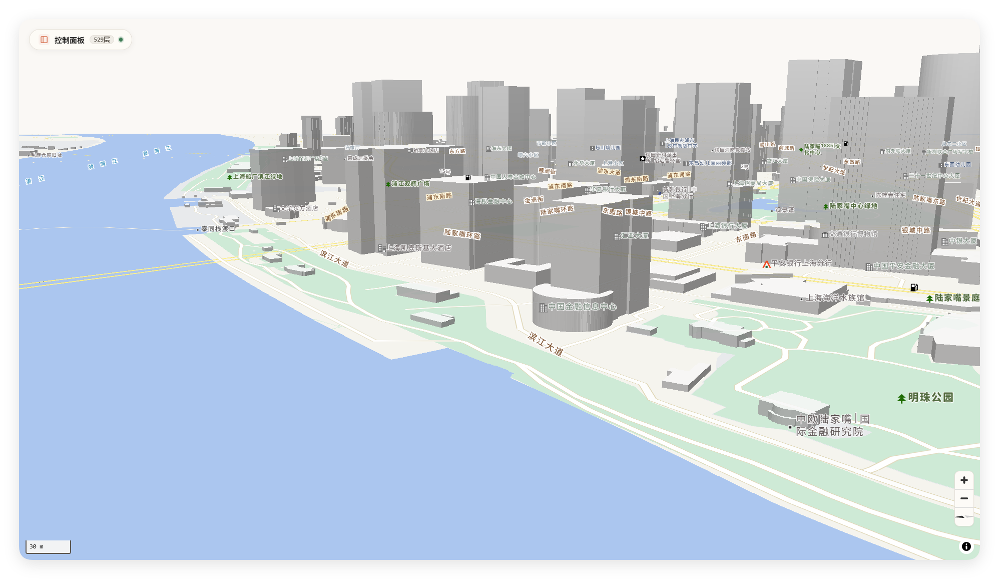
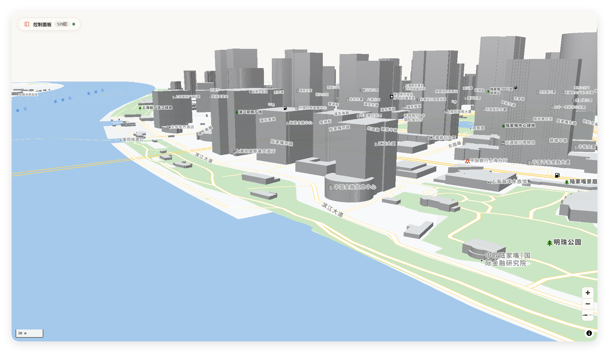
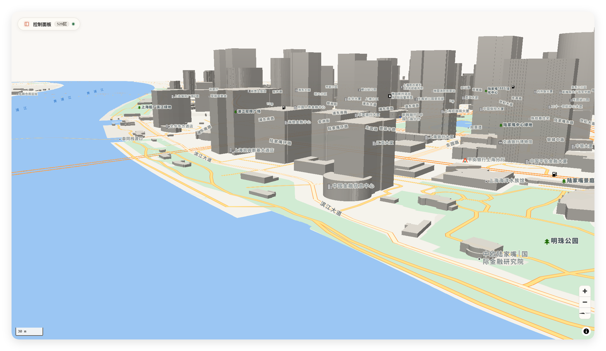
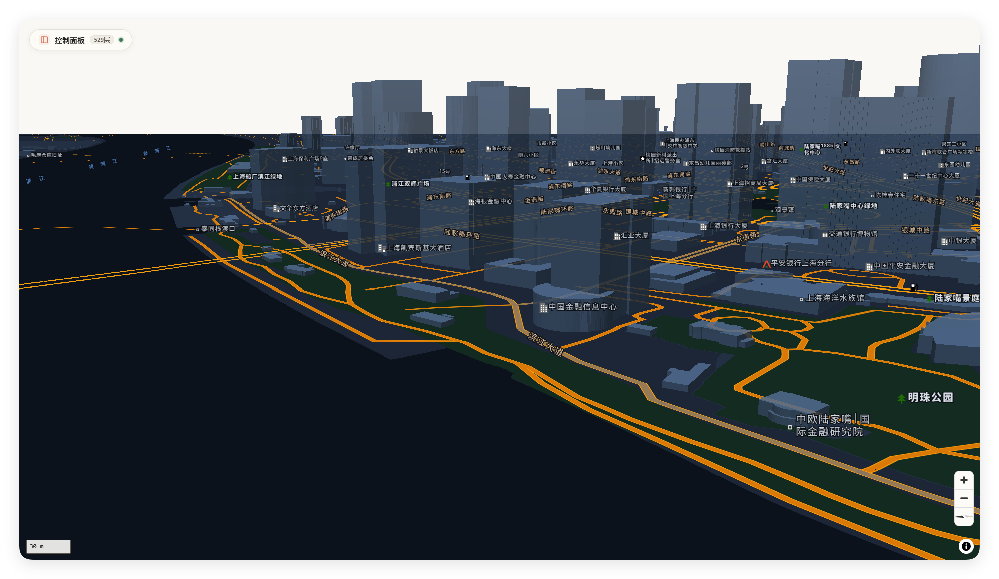
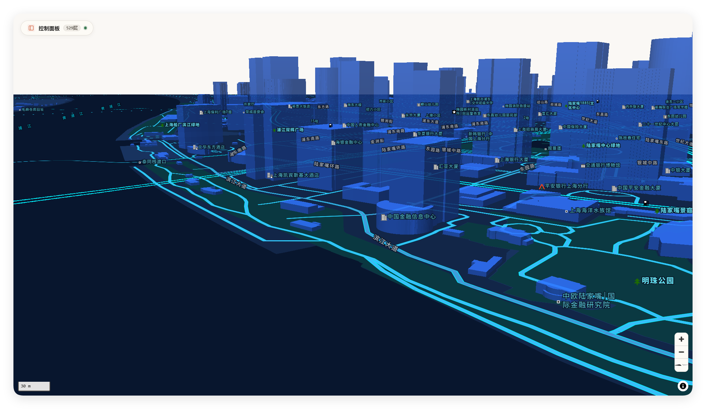

# Tianditu Vector MVT (天地图矢量切片解密与标准化服务)

> **在线体验 Demo**：[https://vpn.negiao.cn/tdt-mvt/](https://vpn.negiao.cn/tdt-mvt/)

天地图官方矢量切片采用了专有的二进制混淆与 Morton 编码规则，常规 GIS 工具及开源地图库无法直接接入。本项目提供了一整套**切片解密、格式转换、样式解耦与标准化分发**的开源解决方案。

---

## 🎨 五套预设精选主题效果

| 🌞 默认官方 | 🌍 谷歌清新 | 🧭 高德素雅 |
| :---: | :---: | :---: |
|  |  |  |

| 🌙 暗夜黑金 | 🌐 科技深蓝 |
| :---: | :---: |
|  |  |

---

## 🌟 核心特性

1. **Node.js 代理服务端解密与格式转换**
   - 零第三方原生 C++ 依赖（纯 Node.js 实现），将官方加密 TVT 字节流逆向解析并转码为符合国际规范的 **Mapbox Vector Tile 2.1** (`.pbf`)。
   - 内置 **5 种专业制图主题**（官方原版、谷歌清新、高德素雅、暗夜黑金、科技深蓝），全量映射 74 个源图层与 529 个样式层。
   - 内置请求去重、并发限流、指数退避重试与本地磁盘 LRU 瓦片持久化缓存。

2. **前端轻量扩展库（浏览器端直连解析）**
   - 提供独立纯前端解码包 `tdt_browser_codec.js`，无需架设后端代理即可在浏览器中通过自定义协议完成切片拉取与解密渲染。
   - 配套 WebGL 交互式样式编辑器，支持 74 个地理图层细粒度调色、参数实时热更新与样式配置导入导出。

3. **桌面端 GIS 快捷载入支持**
   - **ArcGIS Pro**：开箱即用的 `.lyrx` 图层文件，原生支持 `VectorTileServer` 规范。
   - **QGIS**：配套提供 `.qlr` 图层定义文件，支持通过 TileJSON 或标准 XYZ 模板极速载入全要素矢量图层。

---

## 📂 项目结构

```text
TDT-MVT/
├── server.mjs                  # 核心代理服务：切片转换、ArcGIS REST/TileJSON 端点
├── mvt_codec.mjs               # 核心编解码模块：TVT 解密与标准 MVT 2.1 重新封装
├── build_browser_codec.mjs     # 浏览器前端解码库编译脚本
├── style_generator.mjs         # 样式映射预编译脚本（生成 10 套样式 JSON）
│
├── client/                     # 桌面端 GIS 快捷加载图层文件
│   ├── arcgis-pro/             # 5 款主题对应的 ArcGIS Pro 图层文件 (.lyrx)
│   └── qgis/                   # QGIS 一键图层定义文件 (.qlr)
│
├── assets/                     # 基础字典与原始样式元数据
│   ├── data/                   # 字段字典汉化定义
│   └── styles/                 # 官方原始样式描述文件
│
├── preview/                    # 5 种样式效果预览截图
├── static/                     # Web 端交互控制台与静态资源
│   ├── index.html              # 在线可视化平台与交互式制图编辑器
│   ├── tdt_browser_codec.js    # 纯前端直连解码运行时
│   ├── tilejson.json           # 标准 TileJSON 3.0 元数据
│   └── style*.json             # 各主题矢量切片样式规范
│
├── Dockerfile                  # 容器镜像构建文件
├── docker-compose.yml          # Docker Compose 一键编排文件
└── package.json                # 项目元数据与脚本
```

---

## 🚀 快速启动

### 1. 本地 Node.js 启动

> 要求：Node.js >= 18.0.0

```bash
# 复制环境变量模板
cp .env.example .env

# 启动代理服务（默认端口 8890）
npm start

# 开发监听模式
npm run dev
```

启动后在浏览器打开 `http://127.0.0.1:8890` 即可访问交互控制台。

### 2. Docker 部署

```bash
docker-compose up -d
```

---

## 🛠️ 服务端接口与样式对照表

| 样式主题 | Mapbox / MapLibre 样式 URL | ArcGIS Pro VectorTileServer |
| :--- | :--- | :--- |
| **官方默认** | `http://127.0.0.1:8890/style.json` | `http://127.0.0.1:8890/arcgis/rest/services/tdt/VectorTileServer` |
| **谷歌清新** | `http://127.0.0.1:8890/style-google.json` | `http://127.0.0.1:8890/arcgis/rest/services/google/VectorTileServer` |
| **高德素雅** | `http://127.0.0.1:8890/style-amap.json` | `http://127.0.0.1:8890/arcgis/rest/services/amap/VectorTileServer` |
| **暗夜黑金** | `http://127.0.0.1:8890/style-dark.json` | `http://127.0.0.1:8890/arcgis/rest/services/dark/VectorTileServer` |
| **科技深蓝** | `http://127.0.0.1:8890/style-tech-blue.json` | `http://127.0.0.1:8890/arcgis/rest/services/tech_blue/VectorTileServer` |

* **标准 MVT 瓦片源**：`http://127.0.0.1:8890/mvt/{z}/{x}/{y}`
* **TileJSON 元数据**：`http://127.0.0.1:8890/tilejson.json`

---

## 💻 桌面端 GIS 载入指南

### 1. ArcGIS Pro 快速载入
- **方法一（推荐）**：直接将 `client/arcgis-pro/` 目录下对应主题的 `.lyrx` 文件拖入 ArcGIS Pro 地图窗口（如 `tdt-vectors-tech-blue.lyrx`）。
- **方法二**：点击菜单栏「添加数据」->「通过路径添加数据」，输入对应主题的 `VectorTileServer` 地址，服务类型选择 `Vector Tile Service`。

### 2. QGIS 快速载入
- **方法一（推荐）**：直接双击或将 `client/qgis/tdt-vectors-all.qlr` 拖入 QGIS 图层列表，即可自动加载底图与注记全要素。
- **方法二**：在 QGIS 浏览器面板右键「矢量瓦片」->「新建普通连接」，URL 填入 `http://127.0.0.1:8890/tilejson.json` 或 `http://127.0.0.1:8890/mvt/{z}/{x}/{y}`，样式 URL 填写对应主题的 `style*.json`。

---

## 🌐 前端 Web 库接入示例

### MapLibre GL
```javascript
const map = new maplibregl.Map({
  container: 'map',
  style: 'http://127.0.0.1:8890/style-tech-blue.json',
  center: [116.3974, 39.9092],
  zoom: 11
});
```

### OpenLayers (使用 ol-mapbox-style)
```javascript
import olms from 'ol-mapbox-style';

const map = new ol.Map({
  target: 'map',
  view: new ol.View({
    center: ol.proj.fromLonLat([116.3974, 39.9092]),
    zoom: 11
  })
});

olms.apply(map, 'http://127.0.0.1:8890/style-google.json');
```

---

## 📄 许可证

本项目基于 [MIT](LICENSE) 协议开源。
